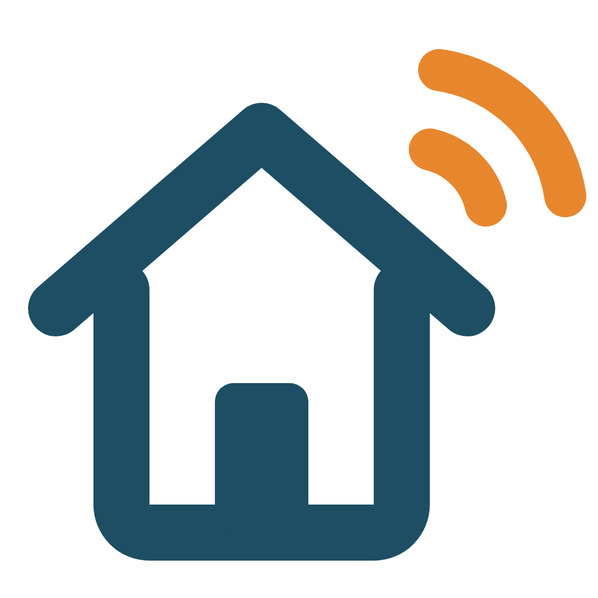
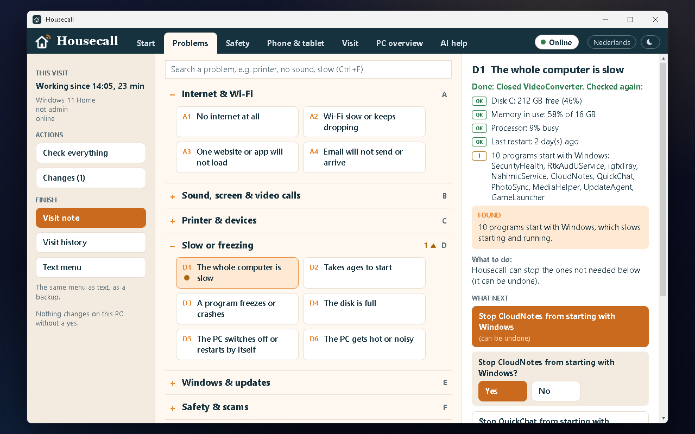
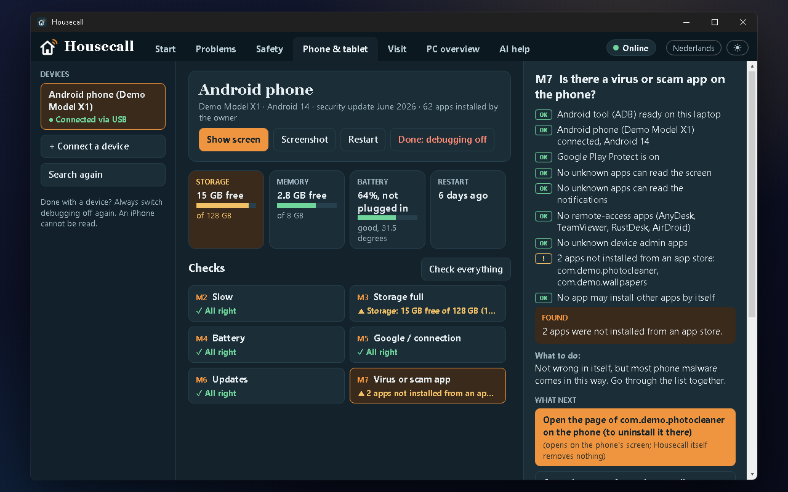

<p align="center">
  <picture>
    <source media="(prefers-color-scheme: dark)" srcset="brand/housecall-icon-white.png">
    
  </picture>
</p>

<h1 align="center">Housecall</h1>

<p align="center"><b>A PC repair helper that finds and fixes computer problems at the client's desk, always with your okay.</b></p>

Paste one line into PowerShell on the PC with the problem:

```powershell
irm housecall.shamilimanuel.nl | iex
```

The long form does the same: `irm github.com/Shamilimanuel/Housecall/raw/main/setup.ps1 | iex`.

<p align="center">
  
  
</p>

<sub>The screenshots show a demo PC and a made-up phone.</sub>

Housecall opens as a window: click a problem (grouped A to G), or **Check everything** at once. It checks that part
of the PC, says what it found in plain English or Dutch, and says what to do about it. The other tabs: **Safety**
(scams and remote-access programs), **Phone & tablet** (Android over USB), **Visit** (the note or invoice, and this
PC's earlier visits), **PC overview** (what this PC is and whether an upgrade helps) and **AI help** (describe it in
your own words). Light and dark, Dutch and English. Without a desktop, or with `-Console`, the same Housecall runs as
a text menu.

- **Read-only until you say yes.** Checking never changes anything. Every fix asks first, is checked again
  afterwards, and can be undone. Or follow the step-by-step instructions to do it by hand.
- **Nothing is installed**, except an optional, signature-checked download of Google's Android platform-tools for
  the phone checks. Close the window and the rest is gone.
- **Works offline.** Once running, the checks don't need internet; it can also run from a USB stick.

## Options

`iex` can't pass options, so they need the longer form:

```powershell
$s = 'github.com/Shamilimanuel/Housecall/raw/main/setup.ps1'
& ([scriptblock]::Create((irm $s))) -DryRun     # check only, never fix
& ([scriptblock]::Create((irm $s))) -Lang nl    # Dutch or English (default: the Windows language)
& ([scriptblock]::Create((irm $s))) -NoAI       # leave the AI chat out
& ([scriptblock]::Create((irm $s))) -Console    # the text menu instead of the window
```

## What it covers

| | Area | What it checks |
|---|---|---|
| A | Internet & Wi-Fi | no internet, slow or dropping Wi-Fi, one website, email |
| B | Sound, screen & video calls | no sound, microphone or camera, screen |
| C | Printer & devices | printer, mouse/keyboard/USB stick, Bluetooth, laptop battery |
| D | Slow or freezing | slow PC, slow start, crashes, disk full |
| E | Windows & updates | updates, error messages, won't shut down |
| F | Safety & scams | fake virus pop-ups, someone got into my PC (AnyDesk, TeamViewer, …), full check |
| G | Files, desktop & accounts | desktop or taskbar gone, files gone, a file opening wrong |
| M | Phone, tablet or car screen | Android over USB: slow, storage, battery, Google sign-in, updates, scam apps |
| | PC overview | model, processor age, Windows support, memory, disks, battery, upgrade advice |
| ? | AI help, visit history, invoice | for the owner's own visits, unlocked with a one-time authenticator code |

## Requirements

Windows 10 or 11 with Windows PowerShell 5.1 (already built in). No administrator rights are needed to run it; a few
fixes ask for them when they need them.

## Privacy

- **Checks stay on the PC.** Checking only reads; nothing changes without a yes.
- **The AI chat and visit history are optional** and need a code from the owner's authenticator app. Only the
  problem you typed and the check results go to the AI: no files, passwords or documents.
- **Visit history** keeps a visit under a scrambled id of the PC (a SHA-256 hash), never a name. Nothing is kept on
  the client's PC.
- **No secrets here.** The AI key and the authenticator secret live on the server, never in this repository.

## Licence

**Not open source. All rights reserved.** This repository only holds the files a PC downloads to run Housecall; it
is public so the one-liner works. You may not copy, reuse or redistribute any of it without written permission. See
[LICENSE](LICENSE).
