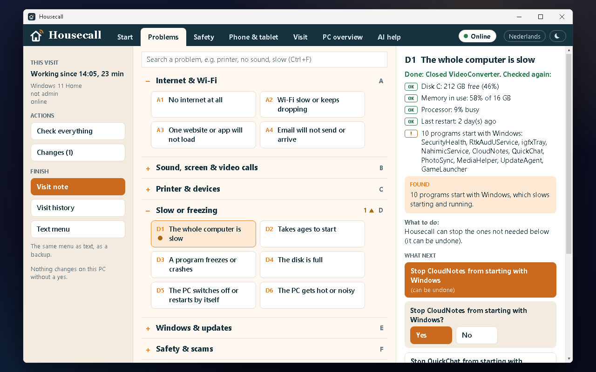
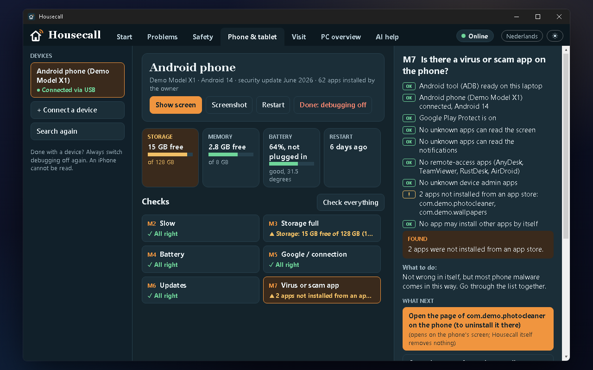
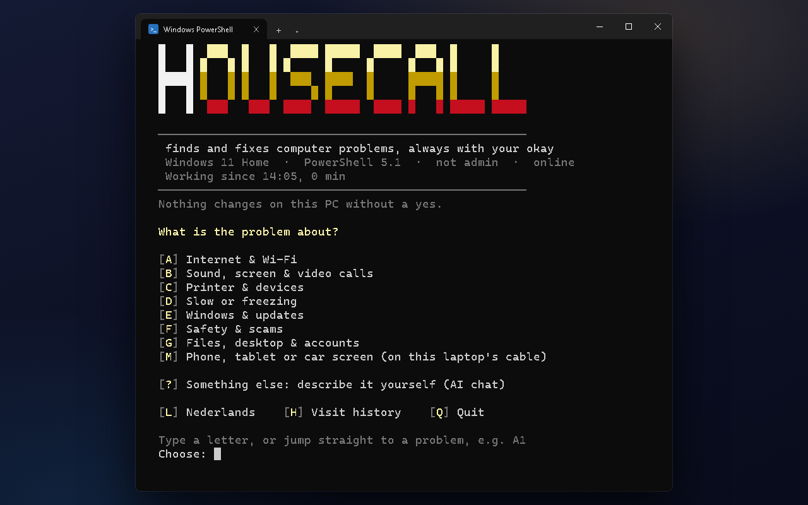

# Housecall

**A PC repair helper that finds and fixes computer problems at the client's desk, always with your okay.**

Paste one line into PowerShell on the PC with the problem:

```powershell
irm housecall.shamilimanuel.nl | iex
```

The long form does the same: `irm github.com/Shamilimanuel/Housecall/raw/main/setup.ps1 | iex`.

<p align="center">
  
  
</p>
<p align="center">
  
</p>

<sub>The screenshots show a demo PC and a made-up phone.</sub>

Housecall opens as a window: click a problem (grouped A to G), or `Alles
controleren` to check everything at once. Housecall checks that part of the
PC, says what it found in plain English or Dutch, and says what to do about it.
The other tabs: **Veiligheid** (scams and remote-access programs), **Bezoek**
(the note or invoice, and this PC's earlier visits), **Pc-overzicht** (what
this PC is and whether an upgrade helps) and **AI-hulp** (describe it in your
own words). Light and dark, Dutch and English.

Without a desktop, or with `-Console`, the same Housecall runs as a text
menu: a letter for the area and a number for the problem (`A1` = no
internet), or `?` for the AI.

- **Read-only until you say yes.** Checking never changes anything. After the
  findings, Housecall offers fixes; each one asks first, is checked again
  afterwards, and can be undone. Or follow the step-by-step instructions to
  do it by hand.
- **Nothing is installed**, except an optional ADB download (Google's Android platform-tools, signature-checked and cached in `%LOCALAPPDATA%\Housecall\platform-tools`), which the phone checks can ask for and which can be deleted. Close the window and the rest is gone.
- **Works offline, from a USB stick.** The one-liner needs internet to download
  Housecall, but once running, the menu and the checks don't. For a PC with no
  internet, bring it on a USB stick (below).

## Options

`iex` can't pass options, so they need the longer form:

```powershell
$s = 'github.com/Shamilimanuel/Housecall/raw/main/setup.ps1'
& ([scriptblock]::Create((irm $s))) -DryRun     # check only, never fix
& ([scriptblock]::Create((irm $s))) -Lang nl    # Dutch or English (default: the Windows language)
& ([scriptblock]::Create((irm $s))) -NoAI       # leave the AI chat (?) out of the menu
& ([scriptblock]::Create((irm $s))) -Console    # the text menu instead of the window
```

## On a USB stick (for a PC without internet)

On your own PC, with the stick plugged in:

```powershell
powershell -ExecutionPolicy Bypass -File tools\make-usb.ps1
```

It rebuilds `setup.ps1` and writes `Housecall\setup.ps1` and
`Housecall\Housecall.cmd` to the stick. At the client's PC, double-click
`Housecall.cmd` (right-click > *Als administrator uitvoeren* when a fix needs
it). Options work too: `Housecall.cmd -Lang nl`.

The copy doesn't update itself. When it runs on a PC with internet, it
compares its build with `version.txt` on GitHub and says so when it is out of
date; run `make-usb.ps1` again then.

## What's built

| | Area | Status |
|---|---|---|
| A | Internet & Wi-Fi | A1 no internet, A2 slow or dropping, A3 one website, A4 email: working |
| B | Sound, screen & video calls | B1 no sound, B2 microphone or camera, B3 screen: working |
| C | Printer & devices | C1 printer won't print, C2 mouse, keyboard or USB stick, C3 Bluetooth, C4 laptop battery: working |
| D | Slow or freezing | D1 slow, D2 slow start, D3 crashes, D4 disk full: working |
| E | Windows & updates | E1 updates, E2 error message, E3 won't shut down: working |
| F | Safety & scams | F1 fake virus pop-up, F2 someone got into my PC (AnyDesk, TeamViewer, …), F3 full check: working |
| G | Files, desktop & accounts | G1 desktop or taskbar gone, G2 files gone or not everywhere, G3 a file not found or opening wrong: working |
| M | Phone, tablet or car screen (Android, on this laptop's USB cable) | M1 overview, M2 slow, M3 storage full, M4 battery, M5 Google sign-in / no connection (incl. a wrong date), M6 updates, M7 virus or scam app (apps with access to the screen or messages, from outside a store, remote-access apps, Play Protect); M1 also shows the phone's screen on the laptop, takes a screenshot and restarts the phone: built, first real test done on the author's own phone. Uses Google's ADB, downloaded once with a yes and signature-checked; the device needs USB debugging on, and the last fix switches it off again |
| | Pc-overzicht | model, processor age, Windows support, memory, disks, battery, with upgrade advice: working |
| ? | AI chat | working, after a one-time setup (below) |
| H | Visit history | working, after the same setup |
| Q | Invoice | at the end of a visit (Bezoek > Afronden): the Authenticator code, a form with a live A4 preview, then a numbered invoice (print or PDF); details via `tools\setup-invoice.ps1` |

## AI chat and visit history: one-time setup

The AI chat (Claude, through a small relay on Supabase that holds the key)
and the visit history are unlocked with a code from Google Authenticator,
once per visit. To set it up, run this on your own PC (not a client's):

```powershell
powershell -ExecutionPolicy Bypass -File .\tools\setup-ai.ps1          # makes the secret, QR code, Supabase and Anthropic steps
powershell -ExecutionPolicy Bypass -File .\tools\setup-ai.ps1 -Check   # only checks the relay
```

Only the typed problem and the check results go to the AI: no files,
passwords or documents. The AI can only pick Housecall's own checks and
fixes, and every fix still asks first.

## Development

`setup.ps1` is generated, so don't edit it by hand. Edit `dev.ps1` and the
files in `src\`, then rebuild:

```powershell
powershell -ExecutionPolicy Bypass -File .\dev.ps1 -Lang nl                 # run from source
powershell -ExecutionPolicy Bypass -Command "Invoke-Pester .\tests"         # tests (Pester 3.4, built into Windows)
powershell -ExecutionPolicy Bypass -File .\build.ps1                        # writes setup.ps1
```

Windows PowerShell 5.1, plain ASCII source files.

## Requirements

Windows 10 or 11 with Windows PowerShell 5.1 (already built in). No administrator rights are needed to run it; a few
fixes ask for them when they need them. The Android checks need a phone on a USB cable with USB debugging on.

## Privacy

- **Checks stay on the PC.** Checking only reads; nothing is changed without a yes, and nothing is installed (apart from that optional ADB download).
- **The AI chat and visit history are optional.** They go through a small relay and need a one-time code from the
  owner's authenticator app. Only the problem you typed and the check results are sent to the AI: no files,
  passwords or documents.
- **Visit history** keeps a visit under a scrambled id of the PC (a SHA-256 hash of its BIOS serial and machine
  UUID), never a name. Nothing is kept on the client's PC. Invoices and receipts made with the invoice feature are
  stored in the owner's own database too, not on the client's PC.
- **The relay holds the secrets** (the AI key and the authenticator secret), so they are never in this public repo.

## Licence

**Source available as a showcase. All rights reserved: please don't reuse it for your own repair service without asking.**

You are welcome to read the code and learn from it. There is no open-source licence, so copying it for your own
use or business needs permission first.

More projects: https://github.com/Shamilimanuel
